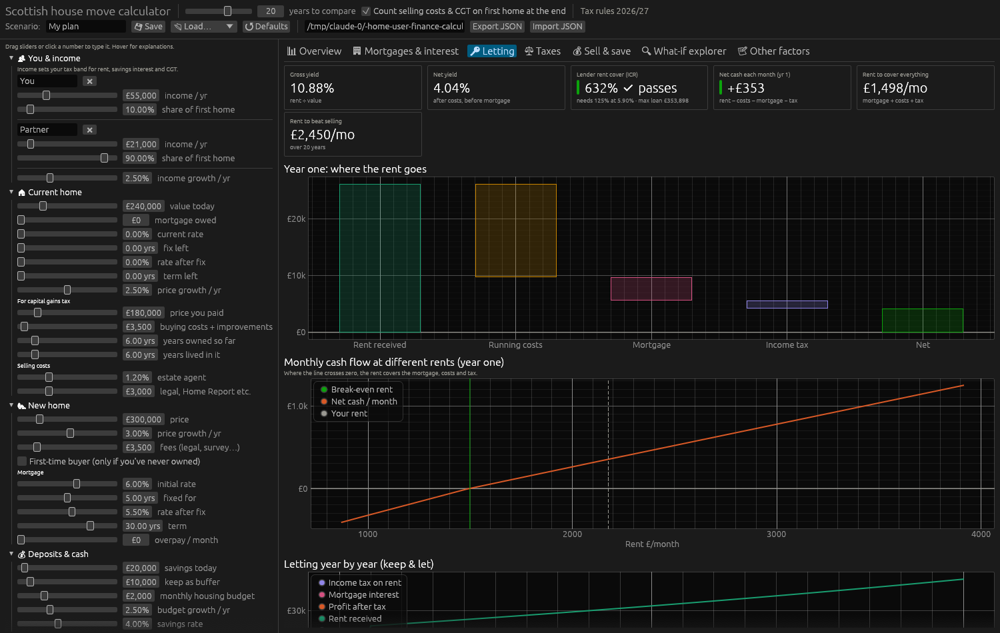
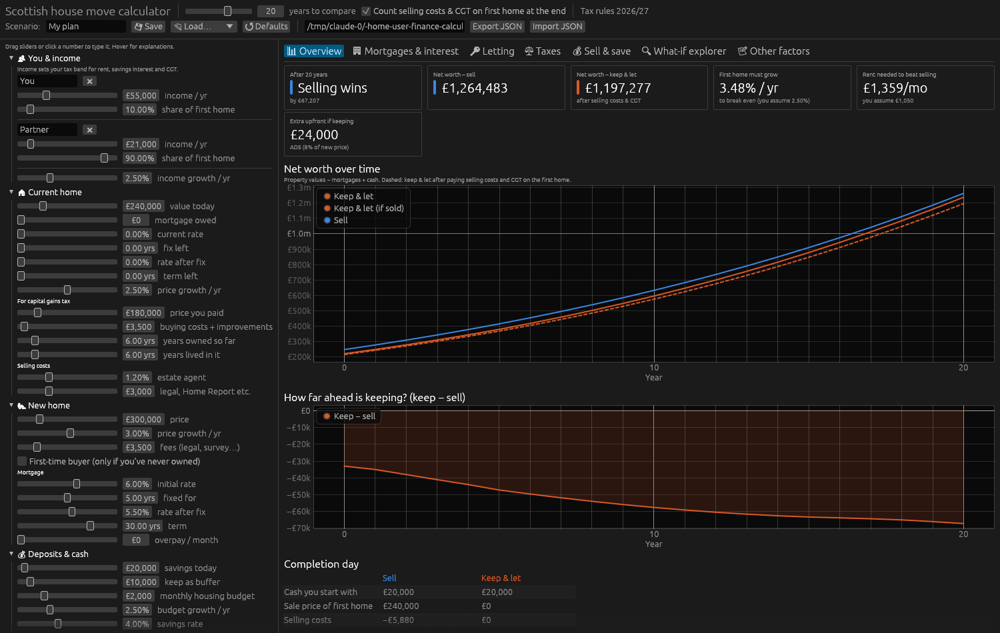
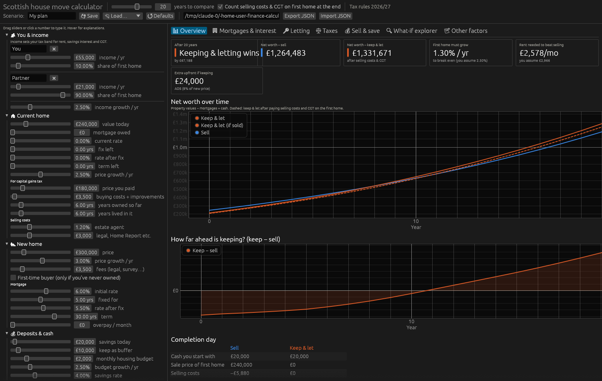

# Airbnb a 1-bed / studio in Leith vs long let vs sell — October 2026

## The legal problem first
Edinburgh is a **short-term let control area**. Letting a whole flat that is not your main home needs **planning permission and** a secondary-letting licence.
- Planning refusal rate: **84%** in the year to April 2026 (464 refused, 88 granted), and **90%** from 2022 to 2024. Council policy is especially hostile to flats on a shared common stair, which describes most Leith tenements.
- Licence (secondary letting, 1–3 guests): **£653** new (2025/26), £1,053 renewal. Fire, gas, electrical and legionella checks, plus public-liability insurance, are mandatory. Operating without permission risks enforcement and fines.
- Since 24 July 2026 there is a **5% visitor levy** on the first 5 nights (usually passed on to guests).
- Available for 140+ nights and let for 70+ nights moves the flat to **non-domestic rates**. Otherwise you pay second-home council tax (double).
- The Furnished Holiday Let tax regime was **abolished in April 2025**, so there are no special reliefs. Mortgage interest gets the same 20% credit as a long let (already in the model).
- Standard BTL mortgages forbid holiday letting, so you need a **holiday-let mortgage** (modelled at 5.9%).

**Most likely outcome: planning is refused and the flat ends up long-let anyway, minus the application and fit-out costs.**

## Numbers (20 years, on the Leith-central assumptions, first home £240k)

Airbnb is modelled as: gross = nightly rate × occupancy, 23% management and platform fees, 10% maintenance, about £7–9k/yr fixed (cleaning, utilities, broadband, insurance, rates, licence, consumables), £12k set-up (planning, licence, furnishing, safety), holiday-let mortgage 5.9%.

| Scenario | Gross/mo | Year-1 net cash | Keep − Sell @20y |
|---|---:|---:|---:|
| Long let, 1-bed at £1,050/mo | £1,050 | +£4.0k/yr | **−£67k** |
| Airbnb weak (£100/night, 55%) | £1,673 | +£1.9k/yr | **−£125k** |
| Airbnb central (£110/night, 65%) | £2,175 | +£4.2k/yr | **−£49k** |
| Airbnb strong (£130/night, 75%) | £2,966 | +£8.2k/yr | **+£67k** |
| *(for reference) 2-bed long let £1,400* | £1,400 | +£6.6k/yr | +£9k |

Gross Airbnb revenue needed to beat selling: about **£2,450/mo** (around £124/night at 65% occupancy, every year, with rates rising in line).

Edinburgh market data: AirDNA (Aug 2026) shows 68% occupancy, ADR falling 5.5% y/y and about 7,500 listings. AirROI shows 57% for the City of Edinburgh. A promotional blog gives Leith £120–£140 and 70–75%. None of these is specific to 1-beds.

| Airbnb central | Letting tab |
|---|---|
|  |  |
| Long let 1-bed  | Airbnb strong  |

## Sources
- Edinburgh Reporter, 84% refusal rate (Apr 2026): https://theedinburghreporter.co.uk/2026/04/short-term-lets-in-capital-have-84-refusal-rate-in-last-year/
- Scottish Housing News, 90% refused: https://www.scottishhousingnews.com/articles/90-of-edinburgh-short-term-lets-applications-refused-planning-permission-since-new-system-introduced
- City of Edinburgh Council licence fees: https://www.edinburgh.gov.uk/licences-permits/short-term-let-licence-application-fees-202324
- Houst, Edinburgh short lets 2026 (levy, rates): https://www.houst.com/blog/edinburgh-short-lets-licence-planning-5-levy
- AirDNA Edinburgh: https://www.airdna.co/vacation-rental-data/app/gb/scotland/edinburgh/overview
- AirROI City of Edinburgh: https://www.airroi.com/airbnb-data/united-kingdom/scotland/city-of-edinburgh
- Edinbnb neighbourhoods (promotional): https://edinbnb.co.uk/airbnb-neighbourhoods-in-edinburgh/
