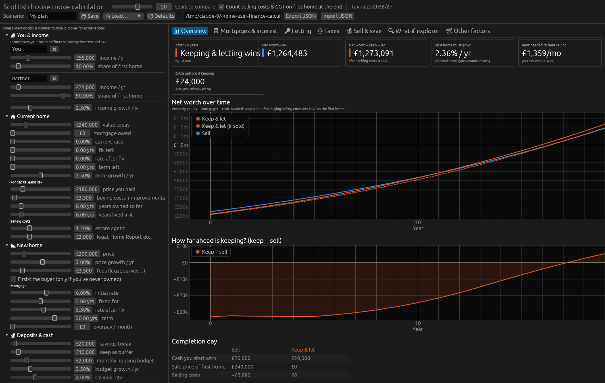
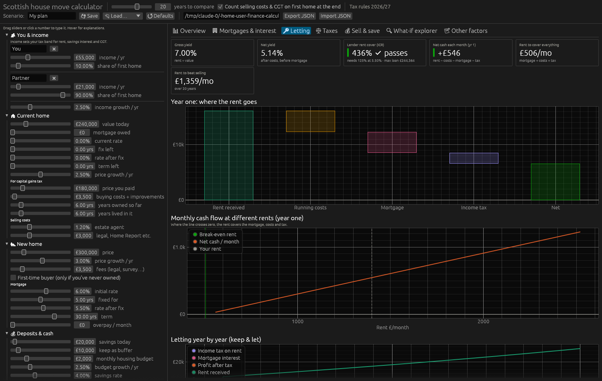
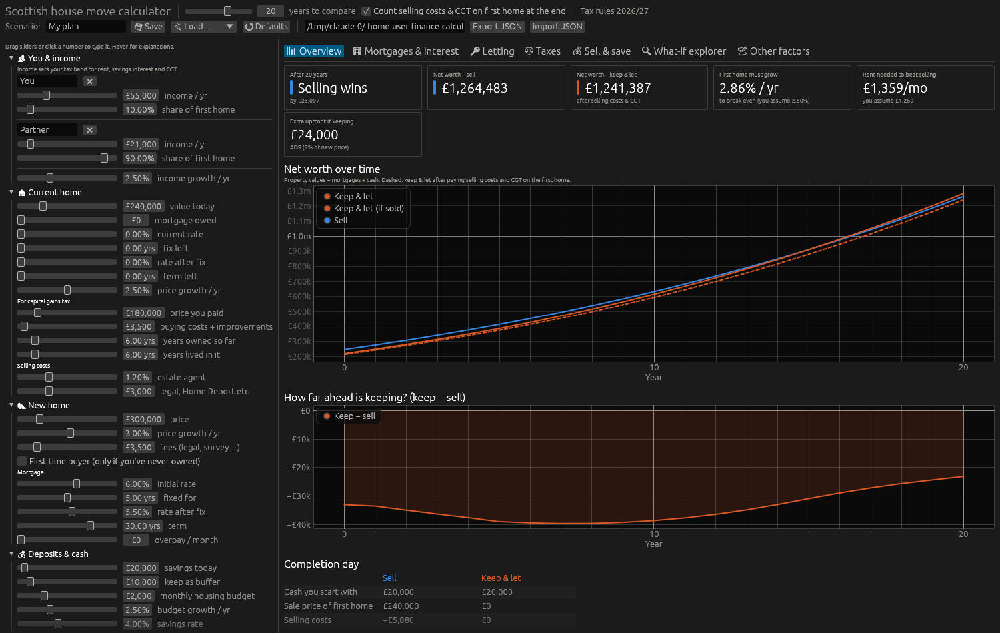
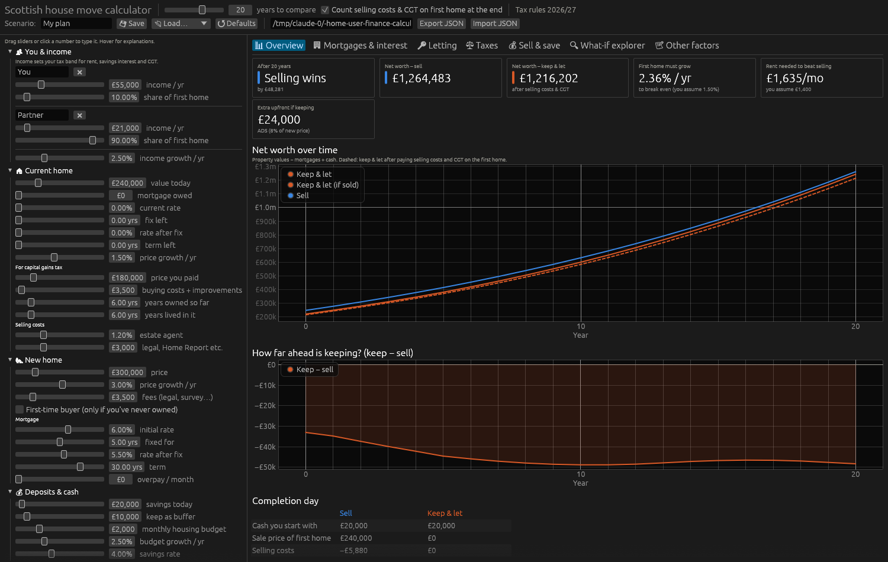

# Leith (EH6) market research and recalibrated runs — October 2026

## What the market says vs your inputs

| Input | You assumed | Leith / Edinburgh evidence | Used in "Leith central" |
|---|---|---|---|
| Rent (2-bed flat) | £1,350/mo | Leith 2-bed asking avg ~£1,430; live listings £1,250–£1,800; Edinburgh all-property ONS index £1,420; one agent quotes £1,050–£1,250 for a 2-bed tenement | **£1,400** |
| Rent growth | 3%/yr | Edinburgh rents +1.4% y/y (ONS, Jun 2026). Rent control areas (CPI+1%, max 6%) possible from 2027 | **2%** |
| First-home price growth | 2.5%/yr | Edinburgh flats +3.0% (ONS, Jul 2026), ESPC flats +2.4%, Leith 1-beds +3.2%; Leith sells in ~15 days | 2.5% (kept) |
| BTL rate (≈29% LTV) | 6.75% | 75% LTV 5-yr fixes 4.6–5.8% (Halifax/Lloyds 5.3–5.5%) | **5.4%**, revert 5.5%, stress 5.5% |
| Residential 5-yr fix | 6.0% | Moneyfacts average 5-yr fix hit 6.0% on 5 Oct 2026 | 6.0% (kept) |
| Savings rate | 5.0% | Bank Rate 3.75% | **4.0%** |
| Letting set-up | £2,000 | EPC band C (new heat-retention rating) proposed for new tenancies from April 2028 — tenements can be costly to upgrade | **£7,000** |

## Results at 20 years (Keep − Sell, after selling costs & CGT)

| Scenario | Sell | Keep & let | Keep − Sell |
|---|---:|---:|---:|
| **Leith central** (table above) | £1,264,483 | £1,273,091 | **+£8,608** |
| Rent £1,250 (tenement end of range) | £1,264,483 | £1,241,387 | −£23,097 |
| Rent £1,500, rent growth 3% | £1,264,483 | £1,319,382 | +£54,899 |
| First home grows 4%/yr | £1,264,483 | £1,380,822 | +£116,339 |
| First home grows 1.5%/yr | £1,264,483 | £1,216,202 | −£48,281 |
| Savings stay at 5% | £1,333,600 | £1,321,149 | −£12,450 |

Leith-central break-evens: rent ≥ **£1,359/mo**, first-home growth ≥ **2.36%/yr**, savings rate ≤ **4.42%**. Keeping is behind for the first ~17 years and only edges ahead at the end. Year-1 letting cash flow ≈ +£546/mo after tax; ICR 436%.

| Leith central | Letting tab |
|---|---|
|  |  |
| Rent £1,250  | Growth 1.5%  |

## Other Edinburgh landlord points
- Rent control: Housing (Scotland) Act 2025 framework started 1 Apr 2026; councils assess by May 2027; Edinburgh seen as a likely early rent control area. Cap on increases CPI+1% (max 6%), none in the first 12 months of a tenancy.
- Edinburgh is a short-term let control area (since 2022): Airbnb-style letting of a whole non-main-home flat needs planning permission plus a licence — plan on a standard PRT let.
- Landlord registration is mandatory (unregistered: up to £50,000 fine).

## Sources
- ONS, Housing prices in Edinburgh — https://www.ons.gov.uk/visualisations/housingpriceslocal/S12000036/
- ESPC House Price Report Aug 2026 — https://espc.com/news/post/house-price-report-aug-2026 ; July 2026 — https://espc.com/news/post/house-price-report-july-2026
- Leith 2-bed rents — https://housesforsaletorent.co.uk/flats-to-rent/edinburgh/leith/ ; https://www.openrent.co.uk/properties-to-rent/leith ; https://flatscout.co.uk/rent/edinburgh
- Kaimes Property, Edinburgh market Mar 2026 — https://www.kaimesproperty.co.uk/blog/edinburgh-property-market-march-2026
- Rent control — https://espc.com/news/post/an-update-on-the-housing-scotland-act-2025 ; https://scottishlandlords.com/news-and-campaigns/news/housing-scotland-act-2025-update/
- BTL rates — https://www.rightmove.co.uk/mortgages/guides/mortgage-rates/buy-to-let-mortgages-btl-mortgage-rates/ ; https://www.halifax.co.uk/mortgages/buy-to-let/current-rates.html ; https://hoa.org.uk/advice/guides-for-homeowners/for-owners/mortgage-rate-forecast/
- EPC — https://www.lexisnexis.co.uk/legal/news/scottish-government-publishes-private-rented-sector-energy-efficiency-consultation-analysis
- Short-term lets — https://www.lawscot.org.uk/news-and-events/legal-news/new-powers-to-control-short-term-lets-in-edinburgh
