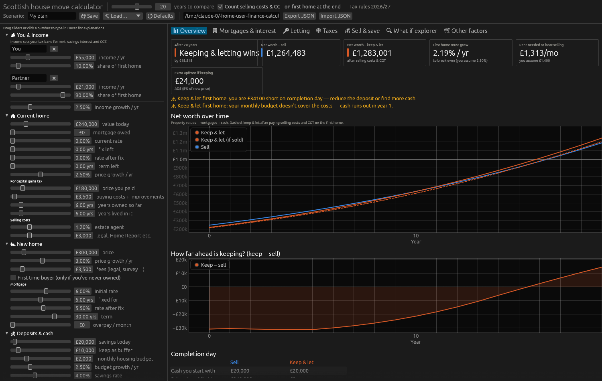
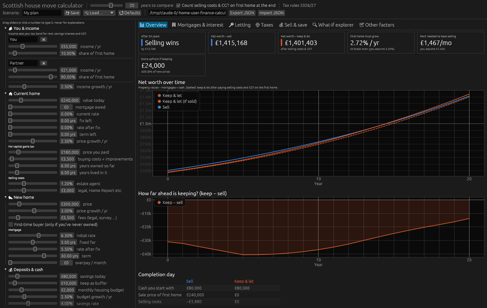
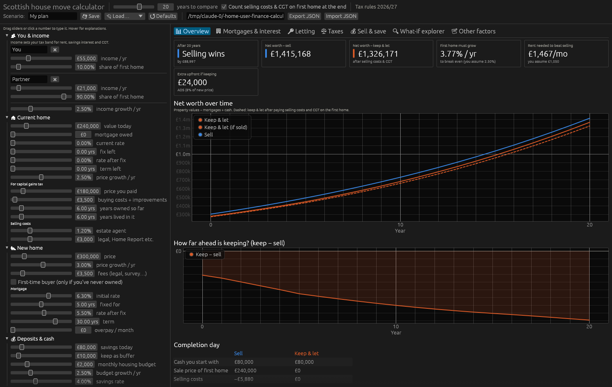

# Mortgage on the new home only (first home kept mortgage-free)

No buy-to-let remortgage and no equity release. All borrowing is a residential mortgage on the £300k new home. Leith-central assumptions otherwise apply.

## Cash needed on completion day (keep & let)
| Item | £ |
|---|---:|
| Deposit 5% / 10% | 15,000 / 30,000 |
| LBTT | 4,600 |
| ADS (8%, refundable only if the first home is sold within 36 months) | 24,000 |
| Fees | 3,500 |
| Letting set-up (incl. EPC work) | 7,000 |
| **Total** | **54,100 / 69,100** |

With your **£20,000** you are **£34,100 short** even at a 95% mortgage ([screenshot](mortgage_on_new/m0_no_release_your_cash.png)). Lenders rarely offer 95% when you keep another property, so a 10% deposit is realistic. That means about **£69k**, or **£79k** with your £10k buffer.

## If you had the cash (£80k savings, 10% deposit, 90% LTV at 6.3%), 20 years

| First-home use | Sell @20y | Keep @20y | Keep − Sell |
|---|---:|---:|---:|
| 2-bed long let £1,400 | £1,415,168 | £1,401,403 | **−£13,766** |
| 1-bed long let £1,050 | £1,415,168 | £1,326,171 | **−£88,997** |
| Airbnb weak (£100, 55%) | £1,415,168 | £1,279,675 | **−£135,493** |
| Airbnb central (£110, 65%) | £1,415,168 | £1,354,086 | **−£61,083** |
| Airbnb strong (£130, 75%) | £1,415,168 | £1,469,823 | **+£54,654** |

Every option comes out worse than borrowing against the first home. Two reasons:
1. Interest on a residential mortgage gets **no tax relief**. BTL interest gets the 20% credit against the rent.
2. A 90% LTV residential loan (about 6.3%) costs more than a roughly 29% LTV BTL loan (about 5.4%).

| No release, your £20k | 2-bed long let | 1-bed long let | Airbnb central |
|---|---|---|---|
|  |  |  |  |
